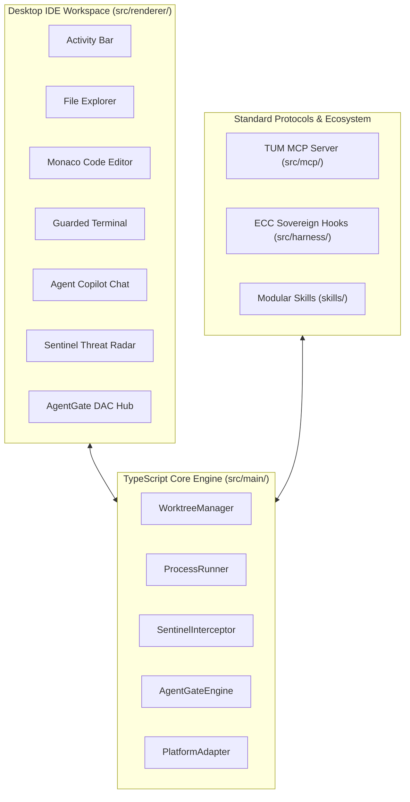

# TUM Sovereign Agent IDE — Software Development Life Cycle (SDLC) Specification
**Document Ref:** `SDLC-TUM-IDE-2026-001`  
**Classification:** Confidential — TUM Group Central Director  
**Target Release:** v1.0.0 Production Enterprise Edition  
**Methodology:** Iterative Agile-SDLC (Requirements -> Architecture -> Implementation -> Verification -> Release)

---

## 1. System Requirements Specification (SRS)

### 1.1 Problem Statement
Modern AI coding assistants (Orca, Cursor, Claude Code) lack sovereign enterprise governance:
1. **Unchecked Shell Execution:** No real-time kernel/AST defense against indirect prompt injections and destructive shell commands.
2. **Missing Cryptographic Provenance:** No cryptographic verification of which human authorized an agent or proof that generated code was signed with quantum-resistant keys.
3. **Siloed IDE vs MCP/Harness:** Developers either get an IDE with no shareable protocols or standalone tools with no unified visual workspace.

### 1.2 Functional Requirements (FR)
* **FR-1 [Desktop IDE Workspace]:** Multi-pane IDE layout containing Activity Bar, Sidebar (File Explorer & Fleet Tree), Center Editor (Monaco Code Editor), Bottom Terminal Panel, and Right Agent Copilot Panel.
* **FR-2 [Monaco Code Editor]:** Integrated Microsoft Monaco Editor supporting full syntax highlighting (TypeScript, C#, JSON, Markdown, HTML, CSS), line numbers, minimap, multi-tabs, and live editing.
* **FR-3 [Real-time File Explorer]:** Interactive directory navigation across workspace files with file icons and one-click opening.
* **FR-4 [Interactive Guarded Terminal]:** Terminal emulator capable of accepting user commands, piping them through TUM Sentinel AST/threat detection, and displaying live output with exit codes.
* **FR-5 [Agent Copilot & Decomposition]:** AI Agent Chat with specialized personas (Architect, Coder, Sentinel Auditor) capable of decomposing architectural visions into parallel Git worktree tasks.
* **FR-6 [Sovereign Fleet Management]:** Live visibility into all 5 TUM repositories with worktree isolation and branch tracking.
* **FR-7 [AgentGate DAC Management]:** Visual interface to mint, inspect, and revoke Delegated Agent Credentials signed with NIST FIPS 204 ML-DSA-65.
* **FR-8 [Sentinel Threat Radar]:** Dynamic behavioral risk gauge (0-100) and tamper-evident circular ring-buffer audit stream.

### 1.3 Non-Functional Requirements (NFR)
* **NFR-1 [Cross-Platform Parity]:** Identical behavior across Windows, macOS, and Linux without platform lock-in.
* **NFR-2 [Zero-Bloat Startup]:** Fast launch within 1.5 seconds via Node.js 22 LTS without requiring heavyweight binary dependencies.
* **NFR-3 [Standards Compliance]:** Fully compatible with Model Context Protocol (MCP) and ECC-style deterministic hooks.

---

## 2. System Design Document (SDD)

### 2.1 Component Interaction Architecture

---

## 3. Implementation Verification & Traceability Matrix

| Requirement | Implementation Artifact | Verification Test |
| :--- | :--- | :--- |
| **FR-1 & FR-2** | `src/renderer/index.html` (Monaco Integration) | Visual verification in browser / dev runner |
| **FR-3** | `src/renderer/index.html` (File Tree Browser) | Click and render file contents |
| **FR-4** | `src/main/process-runner.ts` & Terminal UI | Interactive command execution & Sentinel tests |
| **FR-5** | `src/renderer/index.html` (Agent Copilot) | Vision decomposition & chat flow |
| **FR-6** | `src/main/worktree-manager.ts` | `tests/worktree.test.ts` (100% PASS) |
| **FR-7** | `src/main/agentgate.ts` | `tests/agentgate.test.ts` (100% PASS) |
| **FR-8** | `src/main/sentinel.ts` | `tests/sentinel.test.ts` (100% PASS) |
| **Protocol** | `src/mcp/index.ts` & `src/harness/hooks.ts` | `tests/mcp.test.ts` & `tests/harness.test.ts` (100% PASS) |
